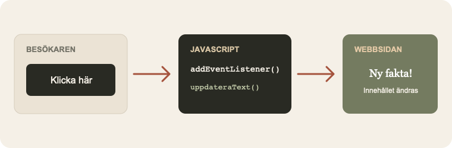
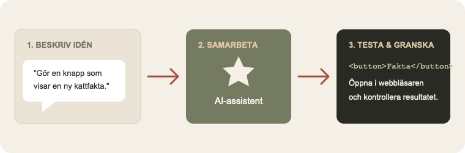

# Veckans insikter

En kort introduktion för dig som är ny inom interaktionsdesign och informationsdesign.

## HTML - Webbsidans information & struktur.

HTML beskriver vad innehållet är och hur det hänger ihop. Rubriker, text och bilder får varsin plats på webbsidan.

```html
<section>
  <h1>Världen blir mjukare med en katt.</h1>
  <p>En katt kan göra vardagen lite mysigare.</p>
</section>
```

## Bootstrap 4.6 - Webbsidans färdiga byggstenar.

Bootstrap erbjuder färdiga CSS-klasser som hjälper dig skapa en layout som anpassar sig till olika skärmstorlekar.

```html
<div class="container">
  <div class="row">
    <div class="col-md-6">En kolumn på större skärmar</div>
  </div>
</div>
```

`container`, `row` och `col-md-6` ordnar innehållet i ett rutnät.

## JavaScript - Webbsidans interaktiva funktioner.

JavaScript gör att sidan kan reagera på besökarens handlingar. På Kattliv ändrar knappen **En till kattfakta** faktatexten när du klickar.



## Vibe Coding - webbsidans AI-assisterade programmering.

Vibe coding innebär att ta hjälp av AI för att skapa och ändra kod genom att beskriva vad du vill göra. Testa resultatet och granska koden — du ansvarar för att den fungerar och att innehållet stämmer.

